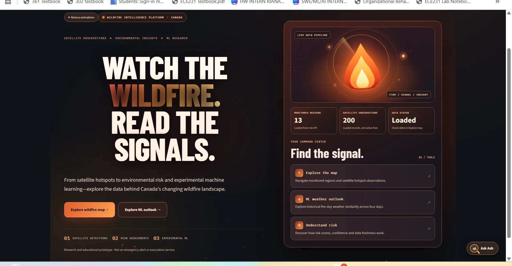
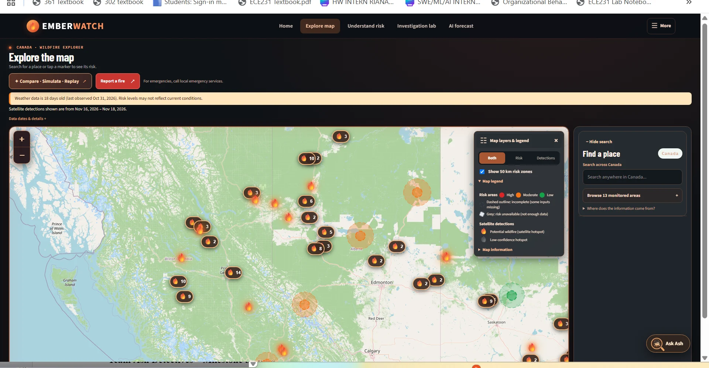
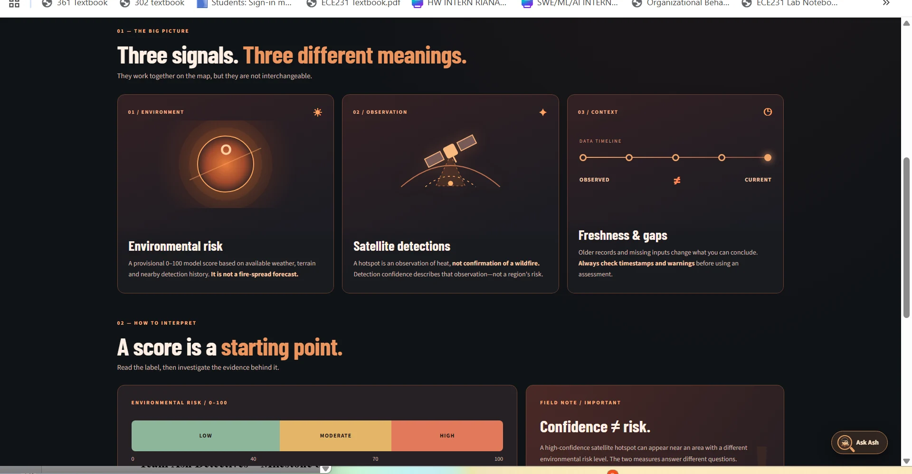
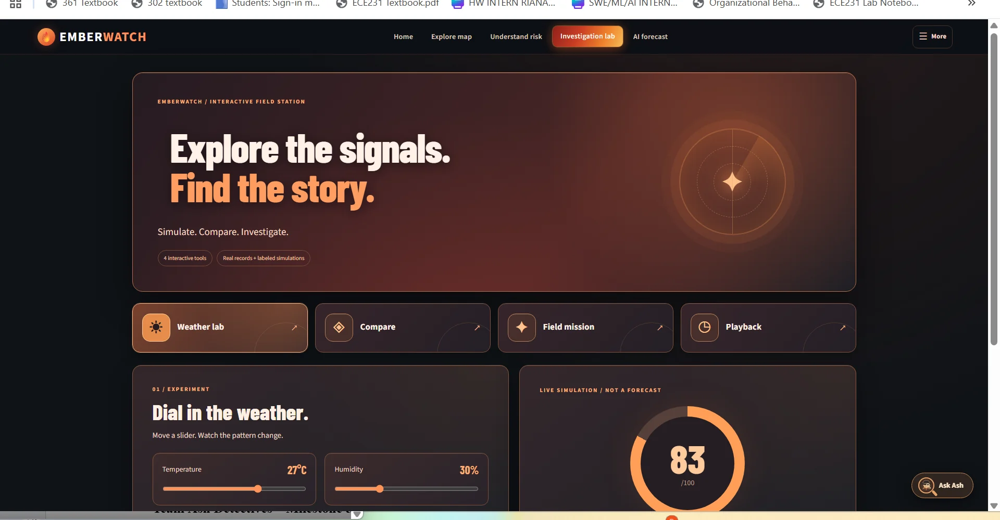
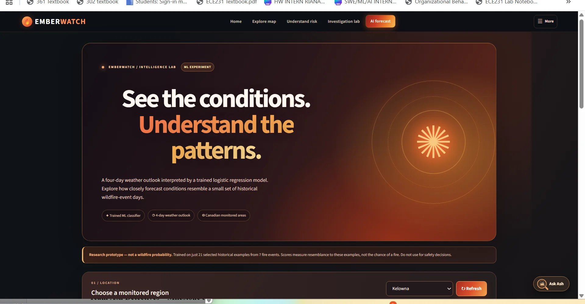
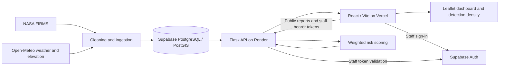

# EmberWatch — Wildfire Early Detection & Risk Monitoring

**Team Ash Detectives · ECE444 Software Engineering · University of Toronto**

[Live dashboard](https://ember-watch-xi.vercel.app/) · [Issues](https://github.com/RianaMalhotra/EmberWatch/issues) · [Project board](https://github.com/users/RianaMalhotra/projects/1) · [Contributing](CONTRIBUTING.md)

> **Educational prototype, not an emergency alert service.** EmberWatch displays satellite-derived detections and experimental environmental risk estimates. Data can be delayed, incomplete, or inaccurate; do not use it for evacuation, firefighting, or other safety-critical decisions.

## Overview

EmberWatch addresses the difficulty of interpreting wildfire observations and environmental risk information across different sources in one accessible interface. It is intended for students, researchers, and members of the public who want to explore and understand wildfire-related data—not for emergency responders making operational decisions. The deployed React/Leaflet dashboard, Flask API, and Supabase PostgreSQL/PostGIS backend bring together monitored Canadian locations, historical and recent NASA FIRMS fire detections, environmental observations, and explainable area-level wildfire risk. **Detection confidence** (certainty associated with a satellite hotspot) and **risk** (a weighted estimate for a geographic area) are different quantities.

## Sprint 6 integration status

Sprint 6 integrates map selection, environmental risk explanations, satellite history, detection-density heatmap, public reports and authenticated staff moderation. See [Sprint 6 integration verification](docs/sprint6-integration-verification.md) for manual verification and remaining gaps. Use Explore → Map layers & legend → Show detection heatmap; the All, Last 24 h and Historical filters apply to the displayed observations. Public reporting and staff moderation were manually verified on production on November 26, 2026.

## Current functionality

| Feature | Implementation and limitations |
| --- | --- |
| Interactive dashboard | React/Vite and Leaflet map with selectable monitored areas, detection markers, area details, and loading/empty/error states. |
| Database-backed area risk | `GET /api/risk-areas` loads monitored areas and environmental inputs from Supabase and computes risk scores. It does **not** return the original three hard-coded mock areas. Unavailable database data produces an error rather than invented observations. |
| Risk zones (#44) | Optional **50 km circular risk-zone overlay** shaded by computed risk; dashed outlines distinguish incomplete assessments. These are model footprints, **not** a continuous interpolated heatmap or fire-spread prediction. |
| Detection heatmap | Optional screen-space density of displayed satellite observations; replaces flame markers, respects age filters, and is not fire severity or modeled risk. |
| Public reports and staff moderation | Public submission and map markers; authenticated staff review and audit history. Community reports are not emergency alerts. |
| Explainable risk (#21, #45, #57) | Weighted 0–100 risk score, LOW/MODERATE/HIGH classification, factor scores, missing inputs, coverage, and model version (`weighted-index-v1`). Area detail exposes contributing environmental factors. |
| Satellite detections (#43, #46) | `GET /api/detections` returns classified database-backed FIRMS observations, timestamps, confidence, and data gaps. `GET /api/detections/history` supports validated geographic and UTC time filters. |
| Data ingestion and freshness (#93, #94) | Scripts and GitHub Actions workflows for Open-Meteo weather refresh and recent NASA FIRMS ingestion. The UI indicates stale observations; scheduled workflows and external feeds can fail and must be verified in deployment. |
| Reliability and contracts (#50, #63) | JSON API errors, degraded/incomplete states, retry behavior, client response-contract tests, and backend tests with an 80% coverage gate. |
| Historical model validation (#57) | Reproducible comparison of seven selected wildfire events against prior-year and winter dates. Fire days scored higher in all seven cases, but only one reached HIGH. This small, selected sample **does not establish accuracy or calibration**. |

**Reporting:** Public submission, map markers, staff sign-in, moderation and audit history were manually verified on November 26, 2026. See [#104](https://github.com/RianaMalhotra/EmberWatch/pull/104), [#112](https://github.com/RianaMalhotra/EmberWatch/pull/112) and [#115](https://github.com/RianaMalhotra/EmberWatch/pull/115).

## Feature highlight — interactive risk map

**Try it:** Open the [live EmberWatch dashboard](https://ember-watch-xi.vercel.app/). On the Leaflet map, select a monitored area to inspect its computed risk level, score, environmental factors, and missing-data information. Toggle **Show 50 km risk zones** to display or hide the shaded circular assessment footprints while retaining selectable area markers. Explore the satellite detection markers to see reported hotspot locations, timestamps, and detection confidence.

The map makes two related but different signals visible together: **area risk** is calculated from environmental factors and historical detections, while **detection confidence** describes a particular satellite observation. Incomplete scores are identified rather than presented as certain. The overlay is a visual approximation around monitored locations, not a prediction of fire spread. A live screenshot can be captured from the dashboard for reports or presentations; the README does not embed a screenshot that might become stale.

## Application screenshots

Explore the [live EmberWatch application](https://ember-watch-xi.vercel.app/) through these five views.

### Homepage — wildfire intelligence at a glance



The landing page introduces the platform and links directly to the map, risk explanations, and experimental ML outlook.

### Wildfire explorer — satellite detections and risk zones



Use **Explore map** to inspect monitored regions, switch map layers, and explore satellite-derived hotspot observations. Detection markers are observations, not confirmed active wildfires; always check the displayed dates and freshness warnings.

### Understand Risk — interpreting the signals



Learn the distinction between an environmental risk score, satellite detection confidence, and the age or completeness of the underlying data.

### Investigation Lab — interactive experiments



Adjust simulated weather conditions and compare outcomes to explore how risk indicators respond. These experiments are educational simulations, not live forecasts.

### AI Forecast — experimental weather outlook



Explore a four-day weather outlook and its similarity to selected historical fire-day conditions. The model's output is **not** a wildfire probability or an emergency warning.

## Risk model and data provenance

The `weighted-index-v1` model combines temperature (15%), relative humidity (20%), wind (15%), precipitation (10%), vegetation/NDVI (10%), terrain slope (5%), and nearby historical detections (25%). Scores are computed from available inputs, with weights renormalized. If available coverage is **below 50%**, no risk score or level is returned. Missing and non-finite measurements are never fabricated.

| Score | Category |
| --- | --- |
| 0–39.9 | LOW |
| 40–69.9 | MODERATE |
| 70–100 | HIGH |

Weather is sourced from **Open-Meteo**; elevation/slope from the Open-Meteo Elevation API; fire observations from **NASA FIRMS**. Stored observations include timestamps and provenance. **NDVI is not yet connected**, so assessments are ordinarily marked incomplete. Risk weights and thresholds are provisional, not statistically calibrated.

See [Risk model, historical validation, and limitations](docs/risk-model.md), [Environmental data](docs/environmental-data.md), [Detection provenance](docs/detection-data-provenance.md), and [Threshold backtest](docs/threshold-backtest.md).

## Architecture



The diagram represents the implemented components, **not** a guarantee that scheduled jobs, external sources, or the live deployment are healthy at any given time.

## API reference

| Method | Endpoint | Purpose |
| --- | --- | --- |
| GET | `/api/health` | Flask service health |
| GET | `/api/health/db` | Database connectivity; 503 when unavailable |
| GET | `/api/risk-areas` | Database-backed monitored areas with scores, factors, coverage, timestamps, and possible warnings |
| POST | `/api/risk-score` | Score supplied environmental inputs; optional location-based history lookup |
| GET | `/api/detections?limit=200` | Classified detections, confidence, counts, and gaps |
| GET | `/api/detections/history` | Historical detections with bounding-box/time filters; the advanced analytics UI supports UTC date and approximate region selection |

| POST | `/api/reports` | Submit an unverified community report |
| GET | `/api/reports` | Public report feed |
| GET | `/api/reports/verified` | Staff-reviewed report feed |
| GET | `/api/staff/reports` | Protected staff report list |
| PATCH | `/api/reports/{id}/status` | Protected status update |
| GET | `/api/reports/{id}/audit` | Protected audit history |

The current response shapes and client validation are documented in [Sprint 4 integration contracts](docs/sprint4-integration-contracts.md). `GET /api/risk-areas` requires a reachable database; the original mock response examples are no longer the current contract.

## Run locally

**Prerequisites:** Git, Python 3, Node.js/npm, and a Supabase database connection for database-backed endpoints.

```bash
git clone https://github.com/RianaMalhotra/EmberWatch.git
cd EmberWatch
cd backend
python -m venv .venv
# Activate .venv for your shell:
# Windows PowerShell: .\.venv\Scripts\Activate.ps1
# macOS/Linux: source .venv/bin/activate
python -m pip install -r requirements.txt
# Copy .env.example to .env and set DATABASE_URL
python app.py
```

In a second terminal, from the repository root:

```bash
cd frontend
npm ci
# Set VITE_API_BASE_URL to the Flask origin, e.g. http://127.0.0.1:5000
npm run dev
```

Open the URL printed by Vite (typically `http://localhost:5173`). If `VITE_API_BASE_URL` is unset, the frontend uses same-origin API paths and needs an appropriate reverse proxy. Configure `CORS_ORIGINS` on the backend to allow the frontend origin. Keep `DATABASE_URL`, API keys, and other secrets in ignored local environment files or deployment secrets, **never** in frontend `VITE_*` variables or committed files.

For reporting, apply `20261112000000_fire_reports.sql` and configure backend `REPORT_HASH_SALT`, `SUPABASE_URL`, `SUPABASE_ANON_KEY`, and `REPORTS_STAFF_USER_IDS` (authorized Supabase Auth UUIDs). Set `TRUSTED_PROXY_COUNT=1` only for the verified single-proxy Render deployment. Set frontend `VITE_ENABLE_REPORTS=true`, `VITE_SUPABASE_URL` (project base URL, without /rest/v1), and `VITE_SUPABASE_ANON_KEY` (public/publishable key only). Never expose service-role keys or the report hash salt.

Apply the relevant migrations in `supabase/migrations/` before running loaders. Use the Supabase **session pooler** connection string. See [Database setup](docs/database.md), [Deployment guide](docs/deployment-vercel-render.md), and [Integration contracts](docs/sprint4-integration-contracts.md).

## Tests and verification

**Acceptance traceability:** [docs/acceptance-traceability.md](docs/acceptance-traceability.md) maps every acceptance criterion of the selected user stories (#2, #3, #4, #5, #6, #8, #9, #10, #12, #13) to its issue, pull request, test result and demo step, and lists the remaining gaps (#66).

Run the following commands from the indicated directories.

**Backend tests and coverage** (from `backend/`):

```bash
python -m pytest -q
python -m pytest -q \
  --cov=services.detection_pipeline \
  --cov=services.detection_validation \
  --cov=services.detection_filter \
  --cov=services.risk_scoring \
  --cov-report=term-missing \
  --cov-fail-under=80
```

The CI coverage gate requires at least **80% statement coverage** across these four critical backend modules.

**Data-processing tests** (from the repository root):

```bash
python -m pytest tests -q
```

**Frontend tests, linting, and production build** (from `frontend/`):

```bash
npm test -- --run
npm run lint
npm run build
```

**Historical model validation** (from the repository root; requires internet):

```bash
python ml/validate_risk_model.py
```

GitHub Actions runs backend, data-processing, and frontend checks on pull requests targeting `main`. See [GitHub Actions](https://github.com/RianaMalhotra/EmberWatch/actions) for current CI status.

Unit tests and mocked service tests **do not** prove live Supabase connectivity or deployed data freshness. For a deployment smoke check, run `python scripts/smoke_check.py https://<backend-host> --frontend-origin https://<frontend-host>` (it checks `/api/health`, `/api/health/db`, populated `/api/risk-areas`, `/api/detections` and CORS; see the [Deployment guide](docs/deployment-vercel-render.md)), then confirm the map handles successful, empty, and failed responses. Data loader instructions are in [Environmental data](https://github.com/RianaMalhotra/EmberWatch/blob/main/docs/environmental-data.md) and [Detection provenance](https://github.com/RianaMalhotra/EmberWatch/blob/main/docs/detection-data-provenance.md).

## Repository layout

```text
backend/          Flask API, database helpers, scoring and detection services, tests
frontend/         React/Vite dashboard, Leaflet components, API clients, Vitest tests
data-processing/  FIRMS cleaning/loading and environmental data scripts
ml/               Historical risk validation script, selected events, results
supabase/         Versioned PostgreSQL/PostGIS migrations
docs/             API contracts, architecture, data provenance, setup and verification
tests/            Cross-component and data-processing tests
.github/workflows/ CI and scheduled ingestion/refresh jobs
```

## Known limitations and next steps

- Model weights, risk levels, and the 50 km zone footprint are **heuristics**; historical validation on seven selected events is a sanity check, not an estimate of predictive performance.
- Satellite detections can include non-wildfire heat sources and may be delayed; historical records must not be presented as confirmed current fires.
- NDVI remains unavailable. Missing environmental values lower coverage, and stale observations may make risk estimates unrepresentative of present conditions.
- Scheduled data refresh, live database connectivity, and deployment health require ongoing verification.
- Further model calibration, broader unbiased evaluation, additional report workflow regression coverage, and reliability hardening remain follow-up work.

## Milestone 5 — Sprint 3 review and final-milestone plan

**Sprint labels and course milestones are separate planning units.** The team originally planned seven development sprints. For Milestone 5, we report the completed Sprint 3 work, acknowledge implementation progress made after Sprint 3, and plan the remaining scope leading to the final course submission (Milestone 6). We are **not retroactively renaming original Sprints 3–5 as “Sprint 3” or Sprints 6–7 as “Sprint 4”**: issue, PR, and historical sprint labels remain unchanged for traceability. The remaining scope can be reprioritized or consolidated within the time available without rewriting completed work's history.

The authoritative current state is the [GitHub project board](https://github.com/users/RianaMalhotra/projects/1), [issues](https://github.com/RianaMalhotra/EmberWatch/issues), and [merged PR history](https://github.com/RianaMalhotra/EmberWatch/pulls?q=is%3Apr+is%3Amerged). Milestone 5's separate group report contains individual task estimates, actual hours, backlog screenshots, and Milestone 6 planning tables.

### Sprint 3 — detection integration, explainable risk, and deployment

| Workstream | Implemented outcome | Evidence |
| --- | --- | --- |
| Detection dashboard (#43) | Connected classified NASA FIRMS observations to map displays; added loading, empty, error, and integration-test coverage | [PR #91](https://github.com/RianaMalhotra/EmberWatch/pull/91), [PR #67](https://github.com/RianaMalhotra/EmberWatch/pull/67) |
| Detection data quality and history (#46) | Validated timestamps, duplicates, and ingestion; added historical detection retrieval with geographic/time filtering and a frontend history client | [PR #83](https://github.com/RianaMalhotra/EmberWatch/pull/83), [#84](https://github.com/RianaMalhotra/EmberWatch/pull/84), [#85](https://github.com/RianaMalhotra/EmberWatch/pull/85), [#89](https://github.com/RianaMalhotra/EmberWatch/pull/89) |
| Risk transparency (#44, #45) | Added environmental-factor explanations on area selection and validation of risk scores before display | [PR #80](https://github.com/RianaMalhotra/EmberWatch/pull/80), [#81](https://github.com/RianaMalhotra/EmberWatch/pull/81) |
| Data completeness and robustness (#27, #28) | Verified database-backed area details and distinguished incomplete/unscored assessments from valid scores | [PR #74](https://github.com/RianaMalhotra/EmberWatch/pull/74), [#75](https://github.com/RianaMalhotra/EmberWatch/pull/75) |
| Deployment and architecture | Deployed frontend/backend with Vercel and Render, added Gunicorn and deployment guidance, and extracted shared modules | [PR #86](https://github.com/RianaMalhotra/EmberWatch/pull/86), [#88](https://github.com/RianaMalhotra/EmberWatch/pull/88), [#96](https://github.com/RianaMalhotra/EmberWatch/pull/96) |

**Sprint 3 outcome:** The project advanced beyond a three-circle mock map to database-backed monitored areas, satellite-derived detection views, historical retrieval, and environmental-factor explanations. This is an educational integration milestone, not evidence of continuous live-feed availability or validated wildfire prediction.

### Additional progress after Sprint 3 — Sprint 4 work already implemented

| Workstream | Implemented outcome | Evidence |
| --- | --- | --- |
| Risk zones and removal of mock fallback (#44) | Rendered optional 50 km risk footprints using actual area scores; preserved selection markers and distinguished incomplete assessments | [PR #99](https://github.com/RianaMalhotra/EmberWatch/pull/99) |
| Weather and detection refresh | Added daily weather refresh with freshness indicators and scheduled recent FIRMS ingestion (subject to external-service and deployment health) | [PR #93](https://github.com/RianaMalhotra/EmberWatch/pull/93), [#94](https://github.com/RianaMalhotra/EmberWatch/pull/94) |
| Dashboard usability | Improved responsive layout, navigation, and presentation | [PR #90](https://github.com/RianaMalhotra/EmberWatch/pull/90), [#92](https://github.com/RianaMalhotra/EmberWatch/pull/92) |
| React–Flask/Supabase contracts (#50, #63) | Added client/backend contract and failure tests and documented environment/database integration requirements | [PR #97](https://github.com/RianaMalhotra/EmberWatch/pull/97), [#98](https://github.com/RianaMalhotra/EmberWatch/pull/98) |
| Model explainability and historical validation (#57) | Checked deterministic scoring, missing-data boundaries, factor weights and provenance; compared seven selected fire days with control dates | [PR #102](https://github.com/RianaMalhotra/EmberWatch/pull/102), [validation documentation](docs/risk-model.md) |
| Public reporting interface (#51) | Added a frontend Report a Fire form; server-side report persistence remains separate work | [PR #76](https://github.com/RianaMalhotra/EmberWatch/pull/76) |

**Outstanding at the time of this update (check live PR status):** [PR #100](https://github.com/RianaMalhotra/EmberWatch/pull/100) (additional external-source and model-failure hardening) and [PR #101](https://github.com/RianaMalhotra/EmberWatch/pull/101) (validated, rate-limited public-report storage) remain open. These should not be described as completed deliverables until merged and verified.

### Remaining planned work toward Milestone 6

The merged implementation is supported by backend Pytest coverage checks, frontend Vitest contracts, lint/build checks, and data/model validation scripts. To reproduce them, use the [Tests and verification](#tests-and-verification) commands above and review [GitHub Actions](https://github.com/RianaMalhotra/EmberWatch/actions). Tests with mocks do not establish that the deployed API, Supabase database, or scheduled feeds are currently healthy.

The original Sprint 5–7 backlog remains useful as a record of the initial plan, **not a claim that three additional course milestones or sprint submissions exist**. The team will consolidate and prioritize its unfinished items for the remaining development period before Milestone 6: verify end-to-end deployed behavior, reconcile and review outstanding PRs, confirm database migrations and data freshness, address model calibration and incomplete NDVI inputs, and prepare the final demonstration, presentation, and report. This is a revised delivery plan, not a retroactive rewrite of sprint completion dates. See the [prioritized backlog](https://github.com/users/RianaMalhotra/projects/1) for up-to-date ownership and status.

## Project tools and links

| Tool / platform | How we use it | URL |
| --- | --- | --- |
| GitHub repository | Source code, branches, version history, and collaboration | [EmberWatch repository](https://github.com/RianaMalhotra/EmberWatch) |
| GitHub Projects | **Project management tool** for the prioritized product backlog, sprint planning, task ownership, and Kanban workflow | [Project board](https://github.com/users/RianaMalhotra/projects/1) |
| GitHub Issues | User stories, acceptance criteria, defects, and task tracking | [Issues](https://github.com/RianaMalhotra/EmberWatch/issues) |
| GitHub Pull Requests | Code review and feature integration | [Pull requests](https://github.com/RianaMalhotra/EmberWatch/pulls) |
| GitHub Actions | CI, automated tests, and scheduled data workflows | [Actions](https://github.com/RianaMalhotra/EmberWatch/actions) |
| Vercel | Hosted React/Vite frontend | [Live dashboard](https://ember-watch-xi.vercel.app/) |
| Render | Hosting for the Flask backend | [Render](https://render.com/) |
| Supabase | Hosted PostgreSQL/PostGIS database | [Supabase](https://supabase.com/) |
| NASA FIRMS | Satellite active-fire observation source | [NASA FIRMS](https://firms.modaps.eosdis.nasa.gov/) |
| Open-Meteo | Weather and elevation data source | [Open-Meteo](https://open-meteo.com/) |

For the Milestone 5 group submission, the **prioritized backlog screenshot**, Sprint 3 task estimates versus actual hours, and Milestone 6 estimates belong in the submitted group PDF; they are not replacements for the README requirements.

## Team and collaboration

Developed by **Team Ash Detectives** for the University of Toronto ECE444 course. See [Team members](team_members.md), [Team workflow](team_workflow.md), [Requirements](docs/requirements.md), [Contributing](CONTRIBUTING.md), and [Code of conduct](CODE_OF_CONDUCT.md).

---

**Disclaimer:** EmberWatch is a student software engineering project. It does not provide official wildfire forecasts, alerts, or evacuation guidance.
