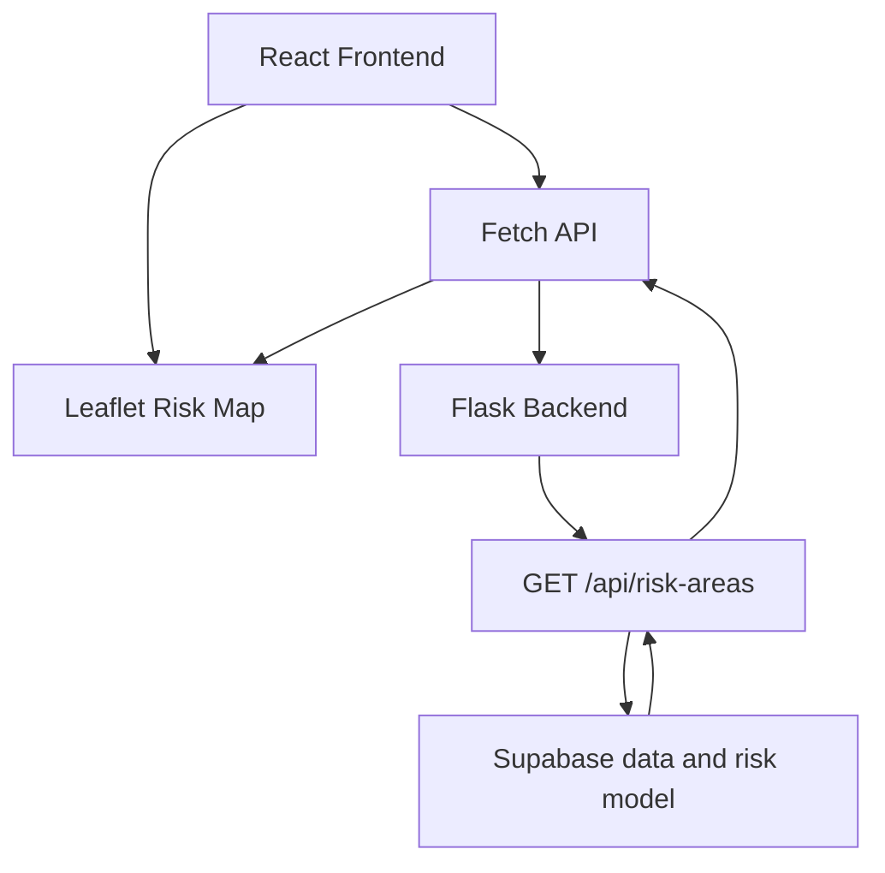
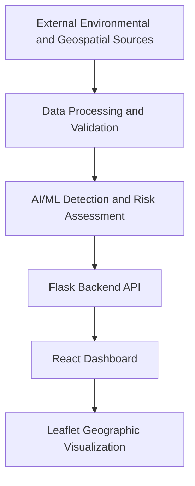

# Wildfire Early Detection and Risk Assessment Platform

🌐 **Live Demo:** https://ember-watch-xi.vercel.app/

**Team Ash Detectives | ECE444 – Software Engineering | University of Toronto**

> **Project Status:** Active Development — Functional React–Flask Prototype  
> The application currently supports an interactive wildfire risk map, backend API communication, detection input validation, and automated backend testing. The risk map shows scores computed by a provisional weighted model from stored weather, terrain and past fire-detection data; they are not a validated forecast and do not represent real-time wildfire conditions.

## 1. Overview

The Wildfire Early Detection and Risk Assessment Platform is a software engineering project designed to help users identify potential wildfire events, explore geographic wildfire risk, and understand environmental conditions contributing to risk.

The platform aims to combine environmental and geospatial information with AI/ML-based analysis and present results through an interactive web dashboard.

The long-term objective is to support understandable, reliable wildfire risk information while clearly communicating detection confidence, environmental conditions, data availability, and system limitations.

The application is being developed incrementally using Agile software engineering practices.

## 2. Current Implementation

The initial application prototype includes:

| Feature | Status | Description |
|---|---|---|
| React frontend | Implemented | Web interface built using React and Vite |
| Interactive geographic map | Implemented | Leaflet map with OpenStreetMap tiles |
| Risk visualization | Implemented | Colored circles for HIGH, MODERATE, and LOW risk, with translucent 50 km risk zones; incomplete and unscored areas are drawn differently |
| Flask backend | Implemented | Python backend exposing REST-style API endpoints |
| Backend health endpoint | Implemented | Checks whether the Flask API is running |
| Risk data endpoint | Implemented | `GET /api/risk-areas` returns each monitored area's risk level, score, contributing factors and data completeness, computed from Supabase data |
| Frontend–backend integration | Implemented | React fetches risk data from Flask |
| Input validation | Implemented as a utility | Validates detection input structure, coordinates, and timestamps |
| Loading and error handling | Implemented | Displays loading and API failure messages |
| Automated backend testing | Implemented | Pytest coverage for initial API and validation functionality |
| AI/ML wildfire detection | In development | Planned detection pipeline and confidence reporting |
| Environmental risk scoring | Implemented (provisional) | Weighted model combining temperature, humidity, wind, rainfall, slope and nearby fire history; vegetation is not yet available, so scores are marked incomplete |
| Continuous geographic heatmap | Planned | A smooth surface between monitored areas; not built, so nothing is estimated for places without data |
| Live environmental data | Partly implemented | Open-Meteo weather and terrain are loaded by `data-processing/load_environment_to_db.py`; there is no automatic refresh and no vegetation source yet |

**Important:** The current application is a functional development prototype, not an operational wildfire monitoring or emergency alert service.

## 3. Key Features

### 3.1 Interactive Wildfire Risk Map

The frontend uses React, React Leaflet, Leaflet, and OpenStreetMap to display geographic wildfire risk information.

The current prototype supports:

- Interactive map navigation and zooming.
- Geographic markers represented by colored circles.
- HIGH, MODERATE, and LOW risk categories.
- Clickable popups displaying risk information.
- Risk areas loaded from the Flask backend.
- Clear identification of demonstration data.

Current risk visualization:

| Risk Level | Color |
|---|---|
| HIGH | Red |
| MODERATE | Orange |
| LOW | Green |

Each monitored area is drawn as a marker with a translucent 50 km risk zone (the radius used for the nearby fire-history count). Zone shading follows the area's own score, and areas without a score get no shading. Nothing is interpolated between areas, so this is not a continuous heatmap; that remains a future enhancement.

### 3.2 Flask Backend API

The backend is implemented using Python and Flask.

It provides API endpoints for application health monitoring and prototype risk-data retrieval.

#### GET /api/health

Returns the operational status of the Flask application.

Example response:

```json
{
  "status": "ok",
  "message": "Wildfire Detection API is running"
}
```

#### GET /api/risk-areas

Returns every monitored area with its computed risk. Scores come from `score_area` in `backend/services/risk_scoring.py`, applied to the latest stored environmental observation and the count of nearby past fire detections. See [component interfaces](docs/component-interfaces.md) for the full field list.

Abbreviated example response (one area, illustrative values):

```json
{
  "status": "success",
  "source": "supabase",
  "data": [
    {
      "id": 1,
      "name": "Example area",
      "latitude": 62.454,
      "longitude": -114.3718,
      "risk_score": 48.4,
      "risk_level": "MODERATE",
      "is_complete": false,
      "missing_inputs": ["vegetation_index"],
      "coverage": 0.9,
      "factor_scores": { "...": "..." },
      "environmental_factors": { "temperature_c": 1.6, "...": "..." }
    }
  ]
}
```

If an area has too little data (less than 50% of the model's weight), `risk_score` and `risk_level` are `null`; no score is invented. Smaller problems return `200` with a `warnings` list, and a database failure returns `503`. The values come from a provisional model and are not a validated forecast.

### 3.3 Detection Input Validation

The backend contains detection input validation functionality.

The validation utility checks:

- Whether the supplied detection input is a dictionary.
- Presence of required geographic coordinates.
- Presence and format of the timestamp.
- Valid latitude and longitude ranges.
- Handling of invalid or incomplete inputs.

Invalid input is rejected with an explanatory validation message.

The validation utility is available for integration with the team's detection pipeline. Its existence does not imply that the complete detection pipeline is operational.

### 3.4 Frontend–Backend Communication

The React frontend communicates with the Flask backend using the JavaScript Fetch API.

The frontend:

1. Requests wildfire risk areas from `/api/risk-areas`.
2. Receives JSON-formatted risk data.
3. Stores the returned data in React state.
4. Renders geographic risk areas on the Leaflet map.
5. Displays loading and error messages when appropriate.

Cross-Origin Resource Sharing (CORS) is configured for local communication between the Vite development server and Flask.

### 3.5 Planned AI/ML Detection and Risk Assessment

The planned detection and risk assessment components will support:

- Analysis of relevant environmental and geographic inputs.
- Identification of potential wildfire events.
- Detection confidence reporting.
- Risk classification based on contributing environmental conditions.
- Communication of missing or uncertain information.
- Integration of calculated results with the interactive dashboard.

**Wildfire risk and detection confidence are separate measures.**

Wildfire risk describes the assessed potential for wildfire in a geographic area. Detection confidence describes how strongly a model supports a particular wildfire detection.

These values should be presented separately to avoid misleading users.

## 4. Technology Stack

| Layer | Technologies |
|---|---|
| Frontend | React, JavaScript, Vite |
| Mapping | Leaflet, React Leaflet, OpenStreetMap |
| Backend | Python, Flask |
| API Communication | REST-style HTTP endpoints, JSON, Fetch API |
| Cross-Origin Requests | Flask-CORS |
| Testing | Pytest, Flask test client |
| Version Control | Git, GitHub |
| Project Management | GitHub Issues, GitHub Projects |
| Collaboration | Pull Requests, code review, Agile sprint planning |
| AI/ML and Data Processing | Under development |

Additional libraries will be documented as the corresponding features are implemented.

## 5. System Architecture

The project follows a modular structure separating the frontend, backend, data processing, and AI/ML responsibilities.

### Current Prototype Data Flow



### Planned Integrated Architecture



The second diagram represents the intended architecture. Not all components are fully implemented or integrated.

## 6. Repository Structure

The repository separates application code, tests, documentation, and planned data-processing and machine-learning components.

```text
EmberWatch/
│
├── backend/
│   ├── app.py
│   ├── requirements.txt
│   ├── services/
│   │   └── detection_validation.py
│   └── tests/
│       ├── test_app.py
│       └── test_detection_validation.py
│
├── frontend/
│   ├── package.json
│   ├── package-lock.json
│   ├── index.html
│   └── src/
│       ├── App.jsx
│       ├── index.css
│       └── services/
│           └── riskApi.js
│
├── data-processing/
├── ml/
├── tests/
├── docs/
│   └── requirements.md
│
├── .gitignore
├── README.md
├── CONTRIBUTING.md
├── CODE_OF_CONDUCT.md
├── team_members.md
└── team_workflow.md
```

This structure highlights the main application and documentation files rather than listing every generated or supporting file.

The `data-processing/`, `ml/`, and top-level `tests/` directories are reserved for their respective development responsibilities. Their presence does not necessarily indicate completed functionality.

## 7. Getting Started

The following instructions describe how to run the current development prototype locally.

### 7.1 Prerequisites

Install:

- Git
- Python 3
- Node.js and npm
- A code editor such as Visual Studio Code

Ensure Python, Node.js, and npm are available from your terminal.

### 7.2 Clone the Repository

```bash
git clone https://github.com/RianaMalhotra/EmberWatch.git
cd EmberWatch
```

### 7.3 Set Up the Backend

Navigate to the backend directory:

```bash
cd backend
```

Create a Python virtual environment:

```bash
python -m venv .venv
```

Activate the virtual environment.

**Windows PowerShell:**

```powershell
.\.venv\Scripts\Activate.ps1
```

**macOS/Linux:**

```bash
source .venv/bin/activate
```

Install the Python dependencies:

```bash
python -m pip install -r requirements.txt
```

The risk map needs the Supabase database. Copy `.env.example` to `.env` in the `backend` folder and set `DATABASE_URL` to the Session pooler connection string (see [Database](docs/database.md)). Never commit `.env`. To fill the tables with weather and terrain data, see [Environmental data](docs/environmental-data.md). Without a working `DATABASE_URL`, `/api/risk-areas` returns `503` and the map shows an error.

Start the Flask application:

```bash
python app.py
```

The backend should run at:

http://127.0.0.1:5000

Available API endpoints:

- http://127.0.0.1:5000/api/health
- http://127.0.0.1:5000/api/health/db
- http://127.0.0.1:5000/api/risk-areas

### 7.4 Set Up the Frontend

Open a second terminal.

From the repository root:

```bash
cd frontend
npm install
npm run dev
```

The Vite development server normally runs at:

http://localhost:5173

Open the URL shown in the terminal.

The frontend requires the Flask backend to be running to retrieve wildfire risk data.

### 7.5 Expected Application Behavior

When both servers are running:

1. The React application loads.
2. The Leaflet map displays geographic information.
3. React requests risk areas from Flask.
4. Flask scores each monitored area from the database and returns the results.
5. One colored circle and a translucent 50 km risk zone are drawn per area. A dashed outline means some inputs are missing; grey means there was not enough data for a score.
6. Hovering a circle shows its risk level and completeness; clicking it opens the details panel with the risk score, environmental factors and missing inputs.
7. The "Show 50 km risk zones" checkbox hides or shows the zones.

If the backend is unavailable, the frontend displays an error instead of presenting missing data as valid risk information.

### 7.6 Troubleshooting

**Frontend loads but no risk areas appear**

Check that the Flask backend is running and that `/api/risk-areas` returns valid JSON.

**API request fails**

Check the browser developer console and Flask terminal for errors. Verify that the backend is running on port 5000.

**Python dependencies are missing**

Run:

```bash
python -m pip install -r requirements.txt
```

from the `backend` directory.

**Frontend dependencies are missing**

Run:

```bash
npm install
```

from the `frontend` directory.

**Port already in use**

Stop the existing development server or adjust the port and corresponding API configuration.

## 8. Testing and Quality Assurance

Automated backend testing uses Pytest.

### Run Backend Tests

From the repository root:

```bash
cd backend
python -m pytest tests -v
```

The initial backend test suite covers:

- Health endpoint response and status code.
- Risk areas endpoint response and data structure.
- Valid detection inputs.
- Missing detection information.
- Invalid geographic coordinates.

At the time of the initial React–Flask integration, all five backend tests passed locally.

### Frontend Verification

The frontend has been manually tested for:

- Successful rendering of the Leaflet map.
- Retrieval of mock risk areas from Flask.
- Display of HIGH, MODERATE, and LOW risk categories.
- Display of demonstration-data labels.

Frontend integration tests and automated CI regression checks were added during Sprint 2; see the milestone update below for current scope.

## 9. Functional and Non-Functional Requirements

Project requirements are documented in:

[docs/requirements.md](docs/requirements.md)

This document contains the selected user stories, acceptance criteria, priorities, and related GitHub Issues.

The project's key requirements include:

- Geographic wildfire detection and risk visualization.
- Clear distinction between wildfire risk and detection confidence.
- Explainable risk factors and environmental conditions.
- Graceful handling of missing or unavailable data.
- Reliable error reporting.
- Maintainable and modular application architecture.

Implementation progress is tracked through GitHub Issues and the project board.

## 10. Agile Development and Project Management

Team Ash Detectives follows an issue-driven Agile development workflow.

The team uses:

| Tool | Purpose |
|---|---|
| GitHub Issues | User stories, bugs, and implementation tasks |
| GitHub Projects | Sprint planning and Kanban tracking |
| Git branches | Isolated feature development |
| Pull Requests | Peer review and controlled integration |
| GitHub documentation | Requirements, collaboration standards, and sprint reports |

### Development Workflow

1. Select a prioritized user story or development task.
2. Create a dedicated Git branch.
3. Implement the feature or improvement.
4. Add or update relevant tests.
5. Run local tests and verify functionality.
6. Open a Pull Request targeting `main`.
7. Request teammate review.
8. Address feedback and merge approved changes.
9. Update the GitHub Project board and sprint documentation.

### Project Resources

- [GitHub Repository](https://github.com/RianaMalhotra/EmberWatch)
- [GitHub Project Board](https://github.com/users/RianaMalhotra/projects/1)
- [GitHub Issues](https://github.com/RianaMalhotra/EmberWatch/issues)
- [GitHub Pull Requests](https://github.com/RianaMalhotra/EmberWatch/pulls)
- [Project Requirements](docs/requirements.md)
- [Contributing Guidelines](CONTRIBUTING.md)
- [Team Workflow](team_workflow.md)

## 11. Development Progress

### Completed Foundational Work

The following components have been implemented and merged:

- Initial React frontend and Leaflet risk map.
- Flask backend initialization.
- Backend health endpoint.
- Python dependency documentation.
- Detection input validation utility.
- Initial automated backend tests.
- React–Flask API integration.
- API-based retrieval of mock wildfire risk areas.
- Frontend loading and error handling.
- Git ignore configuration for generated files and local dependencies.

### Upcoming Development Priorities

The next development stages will focus on:

1. Integrating actual wildfire risk-scoring results into the Flask API.
2. Connecting the detection pipeline with input validation.
3. Incorporating environmental and geospatial data sources.
4. Displaying contributing environmental risk factors.
5. Improving risk visualization beyond circular prototype regions.
6. Strengthening missing-data and service-failure handling.
7. Expanding automated testing and regression coverage.
8. Refining the dashboard's usability and accessibility.

These priorities are subject to sprint planning and team coordination.

## 12. Data Reliability and Limitations

The risk values come from a provisional weighted model applied to Open-Meteo weather and terrain data and to past NASA FIRMS detections stored in Supabase. Vegetation (NDVI) has no data source yet, so every area is currently reported as incomplete.

It does not currently provide:

- Verified real-time wildfire observations.
- Operational wildfire alerts.
- Validated wildfire forecasts.
- Production-grade emergency monitoring.
- Guaranteed detection or risk assessment accuracy.

The platform is an educational software engineering project under active development.

Users should not rely on the prototype for emergency decisions or public safety guidance.

As real data sources and models are integrated, the team intends to communicate uncertainty, missing observations, model confidence, and data freshness clearly.

## 13. Contributing

Contributions should follow the team's established collaboration and review procedures.

Please read:

- [CONTRIBUTING.md](CONTRIBUTING.md)
- [CODE_OF_CONDUCT.md](CODE_OF_CONDUCT.md)
- [team_workflow.md](team_workflow.md)

Team members should link implementation work to GitHub Issues, use dedicated branches, include appropriate tests, and request code review before merging.

## 14. Team

**Team Ash Detectives**

ECE444 – Software Engineering  
University of Toronto

Developed collaboratively as part of the ECE444 course project.

For team membership and responsibilities, see:

[team_members.md](team_members.md)

For collaboration practices, see:

[team_workflow.md](team_workflow.md)

---

**Current Status:** Functional development prototype with React–Flask integration. Detection, risk scoring, environmental data integration, and advanced geographic visualization remain under active development.

---

## M3 and M4 Implementation Update

The sections above document the original project goals, setup instructions, architecture, project links, and team workflow. The following updates clarify features added since that README was first written. **The three circles on the React map still come from mock data**, not live risk assessments.

### Newly implemented backend and data components

| Component | Current state |
| --- | --- |
| Weighted risk-scoring model (#21) | Implemented in `backend/services/risk_scoring.py`. Uses temperature, humidity, wind, rainfall, vegetation, slope, and nearby detections to calculate a 0–100 score and LOW/MODERATE/HIGH category. |
| Risk scoring API | `POST /api/risk-score` accepts environmental inputs and returns a score, coverage, factor scores, missing-input details, and model version. `GET /api/risk-areas` applies the same model to every monitored area for the map. |
| Missing environmental data | The scoring model flags incomplete results and returns a null risk score if less than 50% of its weighted inputs are available. |
| Detection confidence threshold (#19) | Configurable via `MIN_DETECTION_CONFIDENCE` in `backend/config.py`; default is currently 20, based on provisional backtesting. See `docs/threshold-backtest.md`. |
| NASA FIRMS processing | `data-processing/firms_cleaning.py` cleans and deduplicates FIRMS CSV records. VIIRS confidence classes are mapped to approximate numeric values, which are assumptions. |
| Supabase PostgreSQL/PostGIS | Schema in `supabase/migrations/`, connection helper in `backend/db.py`, and setup instructions in `docs/database.md`. Actual connectivity and populated tables still require verification. |
| Database health API | `GET /api/health/db` checks connectivity (200 if reachable, 503 otherwise). |
| API integration tests | `backend/tests/test_sprint1_integration.py` covers the risk-area response contract and mocked database-health outcomes. |

### Updated local development and testing

The existing setup instructions above still apply. To configure the database, copy `backend/.env.example` to `backend/.env` and supply the current Supabase Session pooler connection string. Do not commit credentials. The risk map needs the database: without it `/api/risk-areas` returns 503 and the map shows an error.

From `backend/` run:

```bash
python -m pytest -q
```

From `frontend/` run:

```bash
npm run build
npm run lint
```

See [Sprint 1 Integration Verification](docs/sprint1-verification.md) for browser and database smoke checks. These checks have not all been independently executed as part of this README update. Mocked database tests do not verify live Supabase access.

### Current integration limitations

- `GET /api/risk-areas` scores each monitored area with the risk model (#44), but vegetation has no data source yet, so every area is currently marked incomplete.
- FIRMS cleaning and database utilities are present, but a verified end-to-end live ingestion → detection → risk score → map pipeline is not yet established.
- The map draws a marker and a translucent 50 km zone per monitored area. Nothing is interpolated between areas, so it is not a continuous heatmap.
- The scoring model and confidence threshold are provisional; this application is not a validated forecast or emergency notification service.
- Additional tests for issues #20 and #22 are being developed separately; their inclusion in `main` should be confirmed through the corresponding pull request.

For the latest work and responsibilities, continue using the original [GitHub Project Board](https://github.com/users/RianaMalhotra/projects/1), [Issues](https://github.com/RianaMalhotra/EmberWatch/issues), and [Pull Requests](https://github.com/RianaMalhotra/EmberWatch/pulls) linked above.


---

## P1M4 — Sprint 2 Implementation and Sprint 3 Plan (October 2026)

### Sprint 2 objectives and progress

Sprint 2 prioritized **reliability (user story #4)** and **maintainable modular architecture (user story #12)**, alongside carry-over work from Sprint 1. The team tracked tasks in [GitHub Projects](https://github.com/users/RianaMalhotra/projects/1), using Backlog, Ready, In Progress, In Review, and Done workflow states. Statuses below describe the milestone review snapshot; consult the board and linked pull requests for live status.

| Issue | Sprint 2 work | Milestone review status |
| --- | --- | --- |
| #29 | Define and document component interfaces | Done |
| #30 | Establish CI regression checks and automated coverage baseline | Done |
| #25 | Handle external data-source failures | In progress |
| #26 | Handle API and model-processing failures | In progress |
| #27 | Verify area selection and display of populated Supabase data | In review |
| #28 | Mark derived outputs incomplete when required inputs are missing | In review |
| #31 | Extract shared and reusable modules | In progress |
| #68 | Populate areas and environmental observations using Open-Meteo | Reported completed during Sprint 2; verify deployed data separately |

Sprint 2 also included integration and regression tests, pull request reviews, and frontend/backend coordination. An issue in review or in progress should not be treated as fully delivered until its acceptance criteria and review requirements are satisfied.

### CI and test commands

The backend CI workflow runs Pytest with coverage and an **80% minimum coverage gate** (issue #30). To reproduce the backend check locally, from `backend/`:

```bash
python -m pip install -r requirements.txt
python -m pytest --cov=. --cov-fail-under=80
```

The repository also contains frontend tests and integration checks; from `frontend/`, run the scripts supported by `package.json` (for example `npm run build` and `npm run lint`). Check the [GitHub Actions workflows](.github/workflows) and the latest PR checks for the authoritative current CI configuration. Passing mocked database tests does **not** establish live Supabase connectivity.

### Sprint 3 planned integration

| Issue | Planned deliverable |
| --- | --- |
| #43 | Connect wildfire detection pipeline results to the dashboard |
| #44 | Integrate environmental risk scoring with the geographic risk visualization |
| #45 | Show explainable risk factors when selecting an area |
| #46 | Validate detection ingestion, timestamps, deduplication, and historical storage |

Historical early-warning simulation (#55) remains optional stretch work. Sprint 3 also includes documentation, code reviews, and integration/regression tests.

### Data provenance and limitations

The displayed demonstration circles must not be described as verified live wildfire risk. The risk-scoring service, data-processing utilities, and database infrastructure are distinct from a validated end-to-end live ingestion-to-map workflow. The application remains a student development prototype and is **not** an emergency alert system.

For acceptance criteria and current implementation progress, see [requirements](docs/requirements.md), the [Kanban board](https://github.com/users/RianaMalhotra/projects/1), [issues](https://github.com/RianaMalhotra/EmberWatch/issues), and [pull requests](https://github.com/RianaMalhotra/EmberWatch/pulls).
