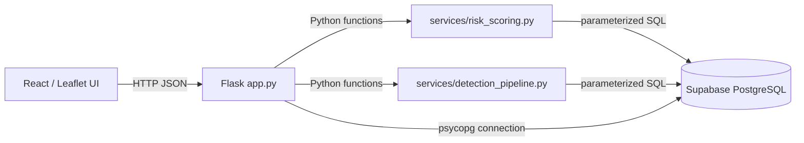

# Component interfaces and API contracts (Sprint 2, #29)

This document describes the **implemented** interfaces on `main`. It is an integration contract for the React UI, Flask API, detection pipeline, risk-scoring service and Supabase PostgreSQL. It does not claim the service provides operational wildfire alerts.

## Component boundaries

| Producer / caller | Consumer / implementation | Interface | Responsibility |
|---|---|---|---|
| React frontend | `frontend/src/services/riskApi.js` | `fetchRiskAreas()` | Fetch and validate top-level risk-area response |
| Frontend service | `backend/app.py` | `GET /api/risk-areas` | Retrieve areas and latest environmental observations, compute risk and return display data |
| Frontend or API client | `backend/app.py` | `GET /api/detections?limit=N` | Return recent classified detections and unavailable-row diagnostics |
| API client | `backend/app.py` | `POST /api/risk-score` | Score supplied environmental factors |
| API client | `backend/app.py` | `GET /api/health`, `GET /api/health/db` | Application and database readiness checks |
| Flask API | `backend/services/risk_scoring.py` | `score_area(inputs: dict) -> dict` | Calculate risk score, classification and completeness metadata |
| Flask API | `backend/services/risk_scoring.py` | `get_area_environmental_data(conn) -> list[dict]` | Read areas and latest observation per area |
| Flask API | `backend/services/risk_scoring.py` | `count_nearby_detections(conn, lat, lon, ...)` | Query historical detection count near a point |
| Flask API | `backend/services/detection_pipeline.py` | `get_classified_detections(conn, limit) -> dict` | Load, validate and classify detection rows |
| Flask API | `backend/db.py` | `get_connection()` | Provide PostgreSQL connection using local environment configuration |

## HTTP API contracts

All JSON API responses include a `status` field. Successful data requests return HTTP 200; invalid JSON bodies return HTTP 400 where specified; unavailable database-dependent requests return HTTP 503. Do not display failure responses as valid wildfire information.

### GET /api/health

**Input:** none. **200:** `{"status":"ok","message":"Wildfire Detection API is running"}`. This checks the Flask process, **not** the database.

### GET /api/health/db

**Input:** none. **200:** `status: "ok"` when database reachable. **503:** `status: "unavailable"` with a message when unavailable. Avoid exposing connection secrets in logs or UI.

### GET /api/risk-areas

**Input:** none; backend requires a configured PostgreSQL connection and relevant tables.

**200:** `{"status":"success","source":"supabase","data":[...]}`. Each item contains:

| Field | Type | Meaning |
|---|---|---|
| `id`, `name` | database identifier, string | Monitored area identity |
| `latitude`, `longitude` | number | Map position |
| `risk_score` | number or null | 0–100 weighted risk estimate; null if insufficient data |
| `risk_level` | `LOW` / `MODERATE` / `HIGH` / null | Risk classification |
| `is_complete` | boolean | Whether every risk input is available |
| `missing_inputs` | string[] | Missing or invalid risk factors |
| `coverage` | number | Available factor-weight fraction (0–1) |
| `factor_scores` | object | Available individual 0–100 factor scores |
| `model_version` | string | Risk-model version |
| `environmental_factors` | object | Raw temperature, humidity, wind, precipitation, vegetation, slope, nearby detections |
| `observed_at` | timestamp or null | Time of latest observation, when available |

**503:** `{"status":"error","message":"Unable to retrieve wildfire risk data"}`. The UI must show an unavailable state; do not silently substitute mock or live-looking values. **Current limitation:** `slope_deg` is set to null in this route because slope data is not yet integrated. Database contents and risk model are not validated real-time wildfire warnings.

### GET /api/detections?limit=N

**Input:** optional `limit`, clamped to 1–1000; default 200. **200:** `{"status":"success","source":"database","detections":[...],"gaps":[...],"threshold":number,"counts":{...}}`.

A detection includes `id`, `latitude`, `longitude`, `timestamp` (UTC ISO 8601), `confidence`, `classification` (`potential_wildfire` or `low_confidence`), `meets_threshold`, and optional source metadata (`satellite`, `instrument`, `frp`, `confidence_class`). `gaps` contains `{id, reason}` for records that cannot be shown safely. `counts` contains `total`, `shown`, `potential_wildfire`, `low_confidence`, and `unavailable`. **503:** `status: "unavailable"` when data cannot be loaded. The configured threshold may produce a server error if invalid; do not represent that as an empty result.

### POST /api/risk-score

**Input:** JSON object with any of `temperature_c`, `relative_humidity_pct`, `wind_speed_kmh`, `precipitation_mm`, `vegetation_index`, `slope_deg`, `nearby_detections`; optionally `latitude` and `longitude` to look up nearby detections if no count supplied.

**200:** `{"status":"success","data":{"risk_score":number|null,"risk_level":string|null,"is_complete":boolean,"missing_inputs":string[],"coverage":number,"factor_scores":object,"model_version":string}}`. **400:** `{"status":"error","message":"Request body must be a JSON object"}` for non-object bodies. Missing/invalid factors are reported, not invented. Database lookup failures for optional nearby history result in a missing factor rather than a fabricated count.

### POST /api/reports (proposed for #52, used by the #51 form)

Not built yet. This is the contract the Report a Fire form (#51) expects, so #52 can be built to match. Change both together if it changes.

**Input:** JSON from `buildReportPayload` in `frontend/src/utils/reportForm.js`:
`{"latitude":number,"longitude":number,"location_source":"gps"|"map","observed_type":"flames"|"smoke"|"both","observed_at":string (UTC ISO 8601),"description":string|null}`. `description` is at most 500 characters.

**201:** `{"status":"success","data":{"id":integer,"review_status":"unverified"}}`. Every new public report starts as `unverified` until staff review it (#53). The form treats any other 2xx body (missing `id`, missing or different `review_status`, not JSON) as a failed save and asks the user to try again; it never assumes the report was stored.

**400:** `{"status":"error","message":string}` for invalid input. **429:** rate limited. **5xx/503:** not saved. The form shows the error and keeps the user's answers.

**Feature flag:** the form only sends reports when the frontend is built with `VITE_ENABLE_REPORTS=true`. Without it, the form runs as a labelled preview and nothing is sent. Turn it on once this endpoint is merged.

## Internal Python interfaces and ownership

- `score_area(inputs)`: pure risk-scoring operation in `services/risk_scoring.py`. Input keys and output contract above. Null/invalid/out-of-range inputs count as missing; coverage below 0.5 yields null risk score and level.
- `get_area_environmental_data(conn)`: returns dictionaries for each `areas` row joined to its latest `environmental_observations` row. Absent observations remain null.
- `count_nearby_detections(conn, latitude, longitude, radius_km=50, min_confidence=None)`: returns an integer count from the database. Caller owns connection lifecycle and handles failures.
- `get_classified_detections(conn, limit=200, min_confidence=None)`: queries and classifies recent `detections`; returns detections, gaps, threshold and counts. `classify_detection(row, min_confidence)` returns `(record, None)` or `(None, reason)`.
- `frontend/src/services/riskApi.js: fetchRiskAreas()`: asynchronous fetch; rejects non-2xx HTTP and payloads where `data` is not an array. React components must handle loading, error and missing-factor states.

## Error-handling and integration rules

1. The frontend must not fabricate risk, confidence, environmental observations or detection locations when an API request fails.
2. Preserve `null`, `missing_inputs`, `is_complete` and `coverage` when displaying partially available assessments.
3. Keep detection confidence distinct from geographic risk level.
4. All DB access stays in backend modules; do not put Supabase database credentials in frontend code or commit `.env`.
5. Add contract/regression tests whenever changing a field name, status code or nullability. Coordinate interface changes with both frontend and backend owners.
6. Database-dependent endpoints require configured `DATABASE_URL`; use `backend/.env.example` for local setup without committing secrets.

## Verification

- Backend: `cd backend && python -m pytest -q`
- Frontend: `cd frontend && npm ci && npm test -- --run && npm run lint && npm run build`
- CI: `.github/workflows/tests.yml` runs backend and frontend checks on pull requests to `main`.

Related issues: #12, #17–#24, #29, #30, #43–#46.
