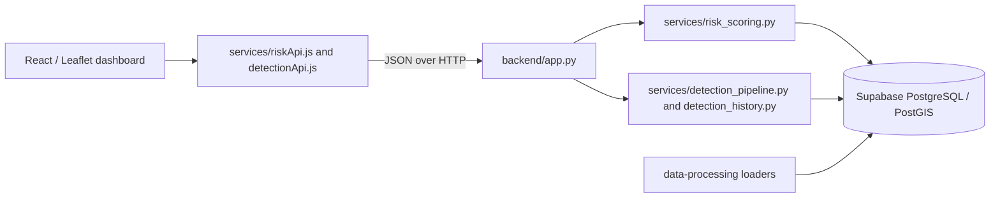

# Sprint 4 — React/Flask integration contracts (#50, #63)

This document describes endpoints and client behavior verified in the current code. It is not a production-readiness claim.

## Architecture

React/Vite dashboard → `frontend/src/services/riskApi.js` and `detectionApi.js` → Flask `backend/app.py` → database-backed services (where configured). Risk scores describe environmental conditions; detection confidence describes a satellite observation. Do not interchange them.

## Verified client contracts

| Endpoint | Client | Required response field | Empty behavior | Invalid response |
| --- | --- | --- | --- | --- |
| `GET /api/risk-areas` | `fetchRiskAreas()` | `data` array | `data: []` is valid | Reject with `Invalid risk data received` |
| `GET /api/detections?limit=200` | `fetchDetections(limit)` | `detections` array | `detections: []` is valid | Reject with `Invalid detection data received` |
| `GET /api/health` | Backend health route | Health JSON | Not applicable | Check HTTP status |

Representative **test fixture**, not a live reading:

```json
{
  "status": "success",
  "source": "database",
  "detections": [{
    "id": 1,
    "latitude": 50.1,
    "longitude": -120.3,
    "timestamp": "2025-07-01T18:30:00Z",
    "confidence": 80,
    "classification": "potential_wildfire",
    "meets_threshold": true
  }],
  "gaps": [],
  "counts": {
    "total": 1,
    "shown": 1,
    "potential_wildfire": 1,
    "low_confidence": 0,
    "unavailable": 0
  }
}
```

The detection client sanitizes invalid coordinates and confidence before rendering map markers. Both clients reject non-JSON or malformed envelopes; failed requests should produce unavailable/error UI, not invented observations.

## Local setup and test commands

From a clean checkout:

```bash
cd backend
python -m venv .venv
# Activate the virtual environment for your shell
python -m pip install -r requirements.txt
python -m pytest tests
python app.py
```

In another terminal:

```bash
cd frontend
npm ci
npm test -- --run
npm run build
npm run dev
```

Set `VITE_API_BASE_URL` to the deployed Flask origin when the frontend is hosted separately. If unset, clients use same-origin `/api` paths, which require a working reverse proxy. Flask CORS must permit the actual frontend origin. The backend database connection is configured through `DATABASE_URL` using the Supabase connection details; keep credentials in local ignored environment files or deployment secrets, never in commits.

## Scope and limitations

- This PR adds client contract regression tests for empty, malformed, and invalid-geography responses. It does not prove a live Supabase connection or the deployed frontend/backend integration.
- Backend routes and database configuration should be verified against the deployed environment before claiming end-to-end success.
- Sprint 4 UI redesign remains under separate review in PR #92. Do not treat a passing contract test as confirmation that all mobile interactions work.
- Existing README project links and setup instructions are preserved; this document supplements them.

## Evidence

- `frontend/src/services/detectionApi.test.js`: detection response and sanitization contracts
- `frontend/src/services/riskApi.test.js`: risk response contracts
- GitHub Actions checks on the accompanying PR provide reproducible CI evidence once completed.


## Supabase schema and data setup (#50)

The authoritative database guide is [docs/database.md](database.md); deployment details are in [docs/deployment-vercel-render.md](deployment-vercel-render.md). The database uses Supabase PostgreSQL with PostGIS. The tracked migrations are in `supabase/migrations/`: `20261014000000_init_schema.sql` defines the initial tables, and `20261018000000_area_terrain.sql` adds terrain fields. Apply migrations in chronological order to the intended Supabase project before running loaders. For later changes, create a new migration rather than editing an applied one. Do not interpret the presence of migration files as proof that a particular remote database has been migrated.

The core tables are `areas` (monitored locations), `detections` (cleaned FIRMS records), `environmental_observations` (dated weather and vegetation inputs), and `risk_assessments` (risk results and completeness metadata). PostGIS geography columns support distance-based queries. The database guide documents RLS and access restrictions; the browser must never receive a PostgreSQL password.

For local database-backed development, copy `backend/.env.example` to the ignored `backend/.env` and set `DATABASE_URL` to the Supabase **session pooler** connection string with valid credentials. Install backend requirements and verify `GET /api/health/db` returns HTTP 200 before claiming the database is reachable. A 503 indicates unavailable database connectivity, not an empty dataset. To load source data, follow [docs/database.md](database.md) for FIRMS and [docs/environmental-data.md](environmental-data.md) for Open-Meteo observations and terrain. The environmental loader requires the terrain migration. Do not commit credentials or set `DATABASE_URL` as a `VITE_*` variable.

## Current implementation versus follow-up work (#50)

| Capability | Repository status | Limitations / evidence |
| --- | --- | --- |
| React/Vite and Leaflet dashboard | Implemented | Map and API integration; see `frontend/src/App.jsx` and `frontend/src/services/` |
| Flask health, risk-area and detection endpoints | Implemented | `backend/app.py`; data-backed routes depend on database availability |
| FIRMS detection ingestion and classification | Implemented pipeline | Requires configured database and ingested data; see `docs/detection-data-provenance.md` |
| Risk scoring and missing-input reporting | Implemented | `backend/services/risk_scoring.py`; incomplete inputs are flagged rather than fabricated |
| Environmental weather/terrain loading | Implemented loader | See `docs/environmental-data.md`; refresh depends on external services and scheduled workflow |
| Vegetation index (NDVI) feed | Not integrated | `vegetation_index` remains unavailable; risk assessments can be incomplete |
| Historical detection filtering | Implemented API | `GET /api/detections/history`; see `docs/detection-history-api.md` |
| Continuous interpolated heatmap | Not established by these contract tests | Distinct from discrete area markers or risk-zone circles |
| Operational wildfire alerts and live end-to-end reliability | Not established | This prototype is not an emergency alert service |

Risk scores and satellite detection confidence remain distinct quantities. Missing values must be surfaced, not silently replaced.

## Module-level data flow (#50)



The React clients validate response envelopes; detection formatting removes invalid geographic points before map rendering. Flask returns JSON error responses rather than inventing records on database failures. In local development Vite proxies API calls when configured; in deployed Vercel builds, `VITE_API_BASE_URL` must be set to the Render backend origin. `CORS_ORIGINS` on Flask must include the frontend origin. See [docs/component-interfaces.md](component-interfaces.md) for detailed boundaries.

## Reproducible verification checklist (#50)

These are **instructions**, not a claim that a new clean checkout or live Supabase deployment was tested during this documentation update.

1. Clone the repository into a new directory; follow the backend and frontend installation commands above. Do not reuse a pre-existing virtual environment or `node_modules`.
2. Run `cd backend && python -m pytest tests` and `cd frontend && npm test -- --run && npm run build` in their respective shells. Record command results and environment versions.
3. Start Flask and confirm `GET /api/health` returns HTTP 200. If using a configured database, also check `GET /api/health/db`, `GET /api/risk-areas`, and `GET /api/detections`; report 503 as unavailable rather than success.
4. Start Vite and confirm that browser network requests target Flask (local proxy) or the configured Render origin, and that CORS allows the actual origin.
5. Record any required external credentials, missing data, or deployment-only steps without including secrets. Attach evidence to PR #97 before claiming clean-checkout completion.

## Pull request and test evidence (#50, #63)

- [PR #97](https://github.com/RianaMalhotra/EmberWatch/pull/97): frontend API contract tests and this integration guide.
- [PR #98](https://github.com/RianaMalhotra/EmberWatch/pull/98): Flask/Supabase mocked contract and failure tests.
- [GitHub Actions checks for PR #97](https://github.com/RianaMalhotra/EmberWatch/pull/97/checks) and [PR #98](https://github.com/RianaMalhotra/EmberWatch/pull/98/checks): use the checks for the **latest commit**, not an older passing run. Mocked tests do not establish live database integration.
