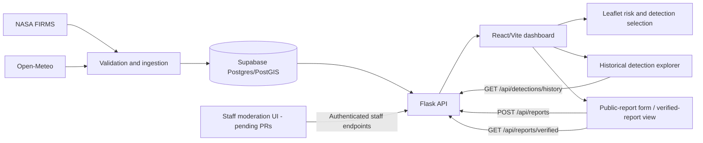

# Sprint 6 integration verification (#58)

This Sprint 6 work integrates the existing interactive dashboard and historic FIRMS retrieval. It is **not** final release preparation or evidence that a production feed is healthy.

## User journeys and current integration status

| User journey | Entry point | Implementation / verification |
| --- | --- | --- |
| Select a monitored area | Overview → Explore → choose area/map marker | Existing Leaflet selection, explainable area risk, missing-input indicators, tests in `frontend/src/App.test.jsx` |
| Inspect satellite observations | Explore → detection markers and layer selector | Timestamp and detection confidence distinct from environmental risk; existing detection contract tests |
| Inspect the environmental risk footprint | Explore → Show 50 km risk zones | Approximate circular footprints, **not** a gridded heatmap or spread simulation |
| Query historical detections | More → Advanced analytics → Satellite detection history | New explicit region/UTC date form; bounded 200-row query, truncation disclosure, error and empty handling; `DetectionHistoryExplorer.test.jsx` |
| Submit a public report | More → Report a Fire | Form is submission-enabled only with `VITE_ENABLE_REPORTS=true` and a configured backend. An unverified report is not an emergency-service notification |
| View verified reports | More → Advanced analytics → Operations dashboard | `GET /api/reports/verified`; only staff-reviewed reports appear, with rounded coordinates. Missing endpoint/error is shown, not replaced by dummy reports |
| Review and moderate reports | Staff workflow | **Dependency:** open PRs #104 and #112 provide role-based access, report moderation and audit/history functionality. Cannot be claimed complete on `main` until merged and deployed |

## Data flow / API contracts



The historical endpoint requires WGS84 south/north/west/east and two timezone-aware ISO-8601 instants; start is inclusive and end exclusive. The form uses whole UTC calendar days, translating the inclusive last day into the next UTC midnight as the exclusive API boundary. Regions are approximate rectangles and may include territory outside provincial boundaries. Each query is capped at 200 returned detections. A `truncated` response tells the user to narrow the query.

The client requires `status: success`, a `detections` array and a boolean `truncated` field, discards invalid coordinates/confidence, applies a request timeout and displays a recoverable error on 400/503 or invalid JSON. No fallback detection or risk observations are fabricated. Detection confidence describes a satellite observation, **not** the modeled area-level wildfire risk.

## Setup and verification

See the root README for Python, Node/npm, Supabase database, migrations, Render and Vercel deployment configuration. Development verification:

```bash
cd frontend
npm ci
npm test -- --run
npm run lint
npm run build

cd ../backend
python -m pytest -q

cd ..
python -m pytest tests -q
```

For a live-data smoke test, confirm `/api/health`, `/api/health/db`, `/api/risk-areas`, `/api/detections` and a filtered `/api/detections/history` query with existing data. Then verify that empty and failing requests do not render invented records. Staff moderation must be checked independently against its protected endpoints, authentication state, and migration once its dependency PRs are merged. Unit tests do not establish live health.

## Related PRs, remaining gaps, Sprint 7 handoff

- Existing dashboard and cross-feature contracts: #91, #97, #98, #99; verified report feed is present in `main`.
- Public-report submission: #101; staff moderation/report history: #104 and #112 (**open dependencies**, check their state before merging).
- Detection-performance work: #105; ML hotspots: #107; threshold evaluation: #111 (open at the time of this write).
- **Sprint 7**: merge and verify staff moderation end-to-end, apply migrations and secrets, validate real reports and staff audit history, reconcile remaining PRs, verify scheduled data ingestion/freshness and actual deployment, decide whether a true interpolated heatmap is required, and record further accessibility/usability or cross-feature defects.

**Issue #58 closure gate:** CI must pass, docs must match merged code, and the staff moderation/history journey must be available and verified together with the public reporting flow. Until those dependencies are satisfied, this PR records substantial integration progress rather than claiming all acceptance criteria are complete.
