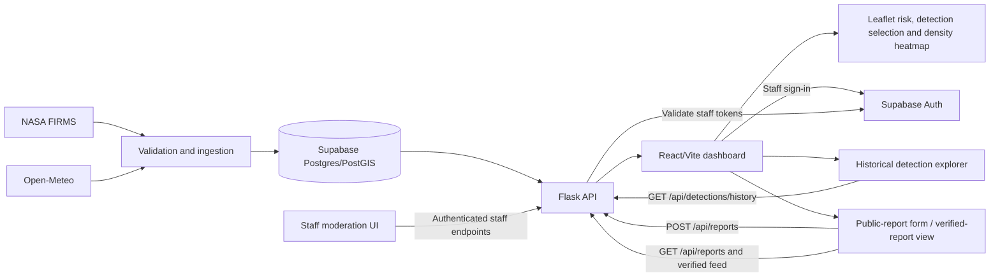

# Sprint 6 integration verification (#58)

This Sprint 6 work integrates the existing interactive dashboard and historic FIRMS retrieval. It is **not** final release preparation or evidence of continuous production feed health. Manual production checks were reported by the project maintainer on November 26, 2026.

## User journeys and current integration status

| User journey | Entry point | Implementation / verification |
| --- | --- | --- |
| Select a monitored area | Overview → Explore → choose area/map marker | Existing Leaflet selection, explainable area risk, missing-input indicators, tests in `frontend/src/App.test.jsx` |
| Inspect satellite observations | Explore → detection markers and layer selector | Timestamp and detection confidence distinct from environmental risk; existing detection contract tests |
| Inspect the environmental risk footprint | Explore → Show 50 km risk zones | Approximate circular footprints, **not** a gridded heatmap or spread simulation |
| Display detection density | Explore → Map layers & legend → Show detection heatmap | Canvas-based relative screen-space density of displayed satellite observations; replaces flame markers and respects age filters. Desktop rendering observed; mobile and age filters confirmed by maintainer. Not fire severity or risk. |
| Query historical detections | More → Advanced analytics → Satellite detection history | New explicit region/UTC date form; bounded 200-row query, truncation disclosure, error and empty handling; `DetectionHistoryExplorer.test.jsx` |
| Submit a public report | More → Report a Fire | Form is submission-enabled only with `VITE_ENABLE_REPORTS=true` and a configured backend. An unverified report is not an emergency-service notification |
| View verified reports | More → Advanced analytics → Operations dashboard | `GET /api/reports/verified`; only staff-reviewed reports appear, with rounded coordinates. Missing endpoint/error is shown, not replaced by dummy reports |
| Review and moderate reports | Staff workflow | Merged PR #104 provides staff authorization, moderation and audit history; merged #112 adds regression tests and documentation. Production sign-in, moderation, audit history and non-staff access checks reported passed |

## Data flow / API contracts



The historical endpoint requires WGS84 south/north/west/east and two timezone-aware ISO-8601 instants; start is inclusive and end exclusive. The form uses whole UTC calendar days, translating the inclusive last day into the next UTC midnight as the exclusive API boundary. Regions are approximate rectangles and may include territory outside provincial boundaries. Each query is capped at 200 returned detections. A `truncated` response tells the user to narrow the query.

The client requires `status: success`, a `detections` array and a boolean `truncated` field, discards invalid coordinates/confidence, applies a request timeout and displays a recoverable error on 400/503 or invalid JSON. No fallback detection or risk observations are fabricated. Detection confidence describes a satellite observation, **not** the modeled area-level wildfire risk.

## Setup and verification

See the root README for Python, Node/npm, Supabase database, migrations, Render and Vercel deployment configuration. Development verification:

```bash
cd frontend
npm ci
npm test -- --run
npm run lint
npm run build

cd ../backend
python -m pytest -q

cd ..
python -m pytest tests -q
```

For a live-data smoke test, confirm `/api/health`, `/api/health/db`, `/api/risk-areas`, `/api/detections` and a filtered `/api/detections/history` query with existing data. Then verify that empty and failing requests do not render invented records. Staff moderation must be checked independently against its protected endpoints, authentication state, and migration after the required migrations and deployment configuration are verified. Unit tests do not establish live health.

## Production verification — November 26, 2026

Maintainer-reported manual checks: public submission and markers, staff login, status updates, audit history, non-staff authorization, historical detections, mobile layout, and heatmap age filtering passed. Desktop heatmap rendering was visible in a supplied screenshot. CI was reported passing by the maintainer; this documentation update does not independently rerun it.

## Related PRs and Sprint 7 handoff

- Dashboard and contracts: #91, #97, #98, #99.
- Reporting and moderation: #101, #104, #112, #115.
- Performance and analytics: #105, #107, #111 (consult GitHub for current merge status).
- Heatmap and responsive controls: commits 0da462d, ef27916, 94379bb, b65f593 and 496a8a6.
- Sprint 7 gaps: context-aware legend, dedicated canvas heatmap regression tests, broader mobile/browser checks, ongoing ingestion/freshness checks, model calibration and missing NDVI. Review API failure paths and report-specific test coverage before final release.
- Heatmap density is relative to the loaded, filtered observations and screen zoom; it is not a count per square kilometre or a fire spread model.

**Closure gate:** Existing CI and manual journeys are reported passing. Documentation is updated; dedicated heatmap regression coverage and independent contract/failure-path review remain outstanding. Do not claim these have been completed.
